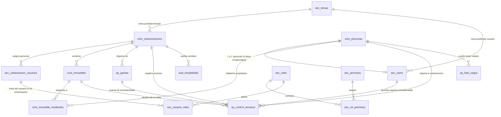
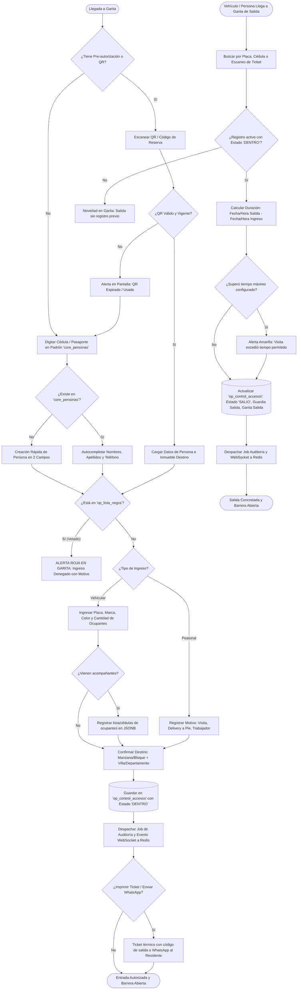

# Plan Maestro Integral: Plataforma Residia (CRM & Control de Acceso)

## 1. Identidad Oficial de la Plataforma
- **Nombre de Marca**: **Residia** (o **Residia OS**)
- **Enfoque**: CRM SaaS Multi-Urbanizaciones, Control Inteligente de Garitas, Seguridad Perimetral y Auditoría.
- **Frontend & Theming**: **Sistema Dinámico de Temas basado en Base de Datos & CSS Variables** (Theming Engine por Urbanización y Personalización por Usuario).

---

## 2. Arquitectura del Módulo de Temas Dinámicos (Dynamic Theming Engine)

Para permitir que cada Urbanización tenga su propia identidad corporativa (o que los usuarios alternen entre modo oscuro, modo claro y paletas de contraste para garita nocturna), el sistema no hardcodeará colores en el CSS. Se implementará un **motor dinámico gobernado desde PostgreSQL y servido a Vue 3**.

### A. Modelo de Datos para Temas

#### Tabla `sec_temas` (Catálogo de Temas del Sistema)
- `tem_id` (INT PK)
- `tem_codigo` (VARCHAR UK: `slate-emerald`, `navy-amber`, `midnight-teal`, `monochrome-guard`)
- `tem_nombre` (VARCHAR: "Slate & Emerald", "Corporativo Marino", "Linear Indigo")
- `tem_es_oscuro` (BOOLEAN)
- `tem_variables_css` (JSONB):
  ```json
  {
    "--bg-primary": "#0F172A",
    "--bg-surface": "#1E293B",
    "--bg-card": "#334155",
    "--text-primary": "#F8FAFC",
    "--text-secondary": "#94A3B8",
    "--color-primary": "#10B981",
    "--color-primary-hover": "#059669",
    "--color-accent": "#38BDF8",
    "--color-warning": "#F59E0B",
    "--color-danger": "#EF4444",
    "--color-success": "#10B981",
    "--border-subtle": "rgba(255, 255, 255, 0.08)",
    "--font-family": "'Plus Jakarta Sans', sans-serif"
  }
  ```
- `tem_activo` (BOOLEAN)

#### Configuración por Urbanización (`core_urbanizaciones.urb_configuracion`)
Cada urbanización puede fijar su tema institucional por defecto y su logo:
```json
{
  "theme_id": 1,
  "custom_colors": {
    "--color-primary": "#0D9488"
  },
  "logo_url": "/storage/logos/urb_cumbaya.png",
  "logo_dark_url": "/storage/logos/urb_cumbaya_dark.png"
}
```

#### Preferencia por Usuario (`sec_users.usr_preferencias` JSONB)
Permite al guardia en garita activar el **"Modo Nocturno / Alto Contraste"** sin afectar al resto del sistema:
```json
{
  "theme_override_id": 2,
  "high_contrast_garita": true
}
```

---

### B. Flujo Reactivo en Vue.js 3
1. **Inyección en el Boot**: Al iniciar sesión o resolver la urbanización, el backend devuelve el payload de configuración del tema activo (con caché en Redis).
2. **Aplicación Instantánea (`useThemeStore` en Pinia)**:
   ```javascript
   // Convierte el diccionario JSONB de la BD en variables CSS en tiempo real
   Object.entries(themeVariables).forEach(([cssVar, value]) => {
     document.documentElement.style.setProperty(cssVar, value);
   });
   ```
3. **Cero Recompilaciones**: Permite a los administradores cambiar los colores institucionales desde la interfaz y ver los cambios reflejados al instante en toda la pantalla sin recompilar Vite/Tailwind.

---

## 3. Stack Tecnológico de Alto Rendimiento

| Capa | Tecnología | Rol y Justificación Técnica |
| :--- | :--- | :--- |
| **Plataforma** | **Residia (Residia OS)** | CRM Multi-Urbanización y Gestión Integral de Garitas. |
| **Backend** | **Laravel 11.x (PHP 8.2+)** | Framework base, API REST robusta, Eloquent ORM y Jobs en cola. |
| **Frontend** | **Vue.js 3 + Pinia + Vite** | SPA reactiva con Dynamic Theme Engine y componentes de garita. |
| **Base de Datos** | **PostgreSQL 15/16** | Padrón relacional con UUIDs, JSONB para temas, diffs de CDC y prefijos modulares. |
| **Caché & In-Memory** | **Redis** | Rate-limiting, validación de Nonces anti-replay y caché de temas/permisos. |
| **Colas Asíncronas** | **Laravel Queues (Redis Driver)** | Desacople de logs de auditoría (CDC), alertas y reportes sin congelar la API. |
| **Tiempo Real (Sockets)** | **Laravel Reverb / Soketi** | Actualización en vivo de garita cuando ingresa o sale un vehículo. |
| **Reportes / Export** | **Laravel Excel + DomPDF** | Generación de reportes tabulares y ejecutivos con sellos de auditoría. |

---

## 4. Convención de Nomenclatura Empresarial (Prefijos en BD y Scripts)

### Prefijos de Tablas por Módulo
| Prefijo | Dominio | Tablas Clave |
| :--- | :--- | :--- |
| **`sec_`** | **Seguridad, Temas & Acceso** | `sec_temas`, `sec_users`, `sec_roles`, `sec_permisos`, `sec_rol_permisos`, `sec_urbanizacion_usuarios`, `sec_usuario_roles`, `sec_api_keys` |
| **`core_`** | **Padrón & Estructura** | `core_urbanizaciones`, `core_personas`, `core_inmuebles`, `core_inmueble_residentes` |
| **`op_`** | **Operaciones de Garita**| `op_garitas`, `op_control_accesos`, `op_vehiculos_frecuentes`, `op_lista_negra` |
| **`aud_`** | **Trazabilidad & CDC** | `aud_trazabilidad`, `aud_reportes_descargas` |
| **`rep_`** | **Vistas de Reportes** | `rep_plantillas`, `rep_programados` |

---

## 5. Diagrama de Entidad Relación Completo



---

## 6. Diagrama de Flujo: Control de Accesos en Garita (Entrada, Semáforo y Salida)



---

## 7. Plan de Implementación por Fases

### Fase 1: Setup de Infraestructura & Proyecto Base
- [ ] Instalación y activación de **Redis** local (`brew install redis && brew services start redis`).
- [ ] Creación del proyecto Laravel en `/Applications/XAMPP/xamppfiles/htdocs/residia-crm`.
- [ ] Configuración del `.env` (PostgreSQL, Redis cache/session/queue).

### Fase 2: Motor de Temas Dinámicos & Migraciones con Prefijos
- [ ] Migración `sec_temas` con paletas predefinidas (*Slate Emerald*, *Navy Amber*, *Midnight Teal*).
- [ ] Migraciones `sec_` (roles, permisos con 5 acciones, usuarios, asignación de urbanizaciones).
- [ ] Migraciones `core_` (urbanizaciones con tema asignado, personas físicas, inmuebles, residentes).
- [ ] Migraciones `op_` (garitas, control de accesos peatonal/vehicular, lista negra).
- [ ] Migraciones `aud_` (trazabilidad transaccional CDC con diffs, log de reportes exportados).
- [ ] Seeders maestros idempotentes.

### Fase 3: Seguridad Perimetral, Middlewares y Auditoría Asíncrona
- [ ] Middleware `ApiShieldMiddleware` (HMAC-SHA256, timestamps de 5 min y Nonces en Redis).
- [ ] Middleware `UrbanizacionTenantScope` (aislamiento estricto por urbanización activa).
- [ ] Middleware `CheckUrbanizacionPermission` (validación de RBAC de 5 dimensiones).
- [ ] Trait `Auditable` + Job asíncrono en cola de Redis.
- [ ] Helper `AuditLogger` para accesos y descargas de reportes.

### Fase 4: Frontend Vue.js 3 + Dynamic Theming Engine + Garita
- [ ] Setup de Vue 3 + Vite + Pinia con inyección dinámica de CSS Variables desde la base de datos.
- [ ] Módulo administrativo de Urbanizaciones (con selector y editor visual de colores de tema).
- [ ] Panel de Garita de alta velocidad (búsqueda por cédula, entrada vehicular con acompañantes, semáforo de permanencia y salida en 1 clic).
- [ ] Sincronización en tiempo real vía WebSockets / Redis.

### Fase 5: Módulo Centralizado de Reportes & Trazabilidad de Impresión
- [ ] Vistas reactivas de reportes con filtros avanzados.
- [ ] Generadores de PDF y Excel con control estricto del permiso `print`.
- [ ] Registro en `aud_reportes_descargas`.
