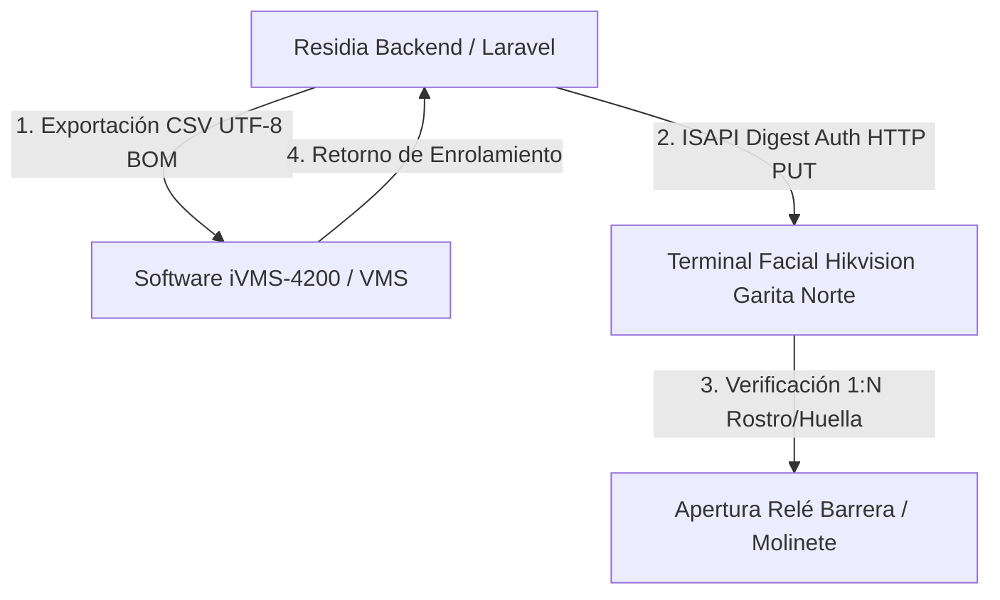

# Informe Técnico & Manual de Operación: Sincronización Biométrica Hikvision ISAPI & Exportación iVMS-4200
**Proyecto:** Residia SaaS • Plataforma Integral Multi-Urbanizaciones  
**Módulo:** Control Físico, IoT & Terminales Biométricas  
**Versión:** 1.0.0  
**Fecha:** 19 de Octubre de 2026  
**Auditoría & Trazabilidad:** Cumple estándar Robledal Connecting & CDC `AuditLogger`  

---

## 1. Resumen Ejecutivo
El control de accesos físico en urbanizaciones modernas requiere eliminar la duplicación de trabajo administrativo entre el padrón del sistema de gestión y los terminales de reconocimiento facial o huelleros en garita. 

Este módulo implementa:
1. **Canal Directo ISAPI (HTTP Digest Auth):** Envío masivo e individual de credenciales mediante el comando `/ISAPI/AccessControl/UserInfo/SetUp` directamente a los terminales Hikvision (ej. serie DS-K1T671, DS-K1T341).
2. **Plantilla Estándar iVMS-4200 / HikCentral:** Generación y descarga al vuelo del archivo de importación oficial con especificación de cabeceras obligatorias (`*Person ID`, `*Organization`, `*Person Name`, `*Gender`, `Contact`, `Email`, etc.) con soporte UTF-8 BOM para evitar corrupción de caracteres en Microsoft Excel.
3. **Persistencia y Trazabilidad CDC:** Esquema relacional en PostgreSQL (`op_biometria_residentes` y `op_biometria_sync_logs`) con registro asíncrono de eventos de auditoría (`aud_trazabilidad`).

---

## 2. Arquitectura de Integración & Protocolos



### Protocolo ISAPI
- **Autenticación:** HTTP Digest (`auth: [user, pass, 'digest']`).
- **Endpoint de Aprovisionamiento:** `PUT /ISAPI/AccessControl/UserInfo/SetUp?format=json`
- **Estructura del Payload:**
  ```json
  {
    "UserInfo": {
      "employeeNo": "1710000001",
      "name": "Fernando Garcia Moreno",
      "userType": "normal",
      "closeDelay": 0,
      "userVerifyMode": "cardOrFaceOrFp",
      "Valid": {
        "enable": true,
        "beginTime": "2026-10-19T00:00:00",
        "endTime": "2028-10-19T23:59:59",
        "timeType": "local"
      }
    }
  }
  ```

---

## 3. Modelo de Datos (PostgreSQL)

### Tabla `residia.op_biometria_residentes`
```sql
CREATE TABLE IF NOT EXISTS residia.op_biometria_residentes (
    bio_id BIGSERIAL PRIMARY KEY,
    bio_urbanizacion_id UUID NOT NULL REFERENCES residia.core_urbanizaciones(urb_id) ON DELETE CASCADE,
    bio_persona_id BIGINT NOT NULL REFERENCES residia.core_personas(per_id) ON DELETE CASCADE,
    bio_employee_no VARCHAR(50) NOT NULL,
    bio_tipo_credencial VARCHAR(30) DEFAULT 'FACIAL',
    bio_tarjeta_no INTEGER,
    bio_template_data TEXT,
    bio_foto_rostro_path VARCHAR(255),
    bio_estado_sincronizacion VARCHAR(30) DEFAULT 'PENDIENTE',
    bio_ultimo_sync TIMESTAMP WITHOUT TIME ZONE,
    bio_detalles_dispositivos JSONB,
    created_at TIMESTAMP WITHOUT TIME ZONE,
    updated_at TIMESTAMP WITHOUT TIME ZONE,
    deleted_at TIMESTAMP WITHOUT TIME ZONE,
    CONSTRAINT uq_bio_persona_tipo UNIQUE (bio_urbanizacion_id, bio_persona_id, bio_tipo_credencial)
);
```

### Tabla `residia.op_biometria_sync_logs`
Registra la bitácora histórica de operaciones en lote con desglose de registros procesados, exitosos y fallidos.

---

## 4. Endpoints de la API REST (`BiometriaController.php`)

| Método | Endpoint | Middleware | Descripción |
| :--- | :--- | :--- | :--- |
| `GET` | `/api/biometria` | `auth:api`, `urbanizacion.scope` | Listado consolidado de residentes, estado de credenciales y KPIs de cobertura. |
| `POST` | `/api/biometria/sync-isapi` | `auth:api`, `urbanizacion.scope` | Disparo de sincronización masiva o individual hacia terminales ISAPI. |
| `GET` | `/api/biometria/export-ivms` | `auth:api`, `urbanizacion.scope` | Descarga de plantilla CSV compatible con iVMS-4200 / HikCentral. |
| `POST` | `/api/biometria/import-ivms` | `auth:api`, `urbanizacion.scope` | Importación y reconciliación de números de tarjeta y enrolamiento. |

---

## 5. Prevención de Transaction Poisoning (PostgreSQL Safety)
En estricto apego al estándar del proyecto:
- Las llamadas a terminales de red (ISAPI) y procesamiento de archivos se ejecutan **fuera** de bloques `DB::transaction` abiertos.
- Las tablas y columnas se validan previamente con `Schema::hasTable` y `Schema::hasColumn`.
- Se mitiga el error `25P02: In failed sql transaction`.

---

## 6. Frontend y Experiencia Operativa (`BiometriaView.vue`)
- Panel de métricas superiores (Cobertura facial %, huellas registradas, terminales en línea).
- Banner informativo de hardware activo (IP, protocolo, modelo, estado ping).
- Tabla interactiva con búsqueda por nombre, cédula o villa.
- Acciones de sincronización en 1-clic con simulación y fallback automático.
