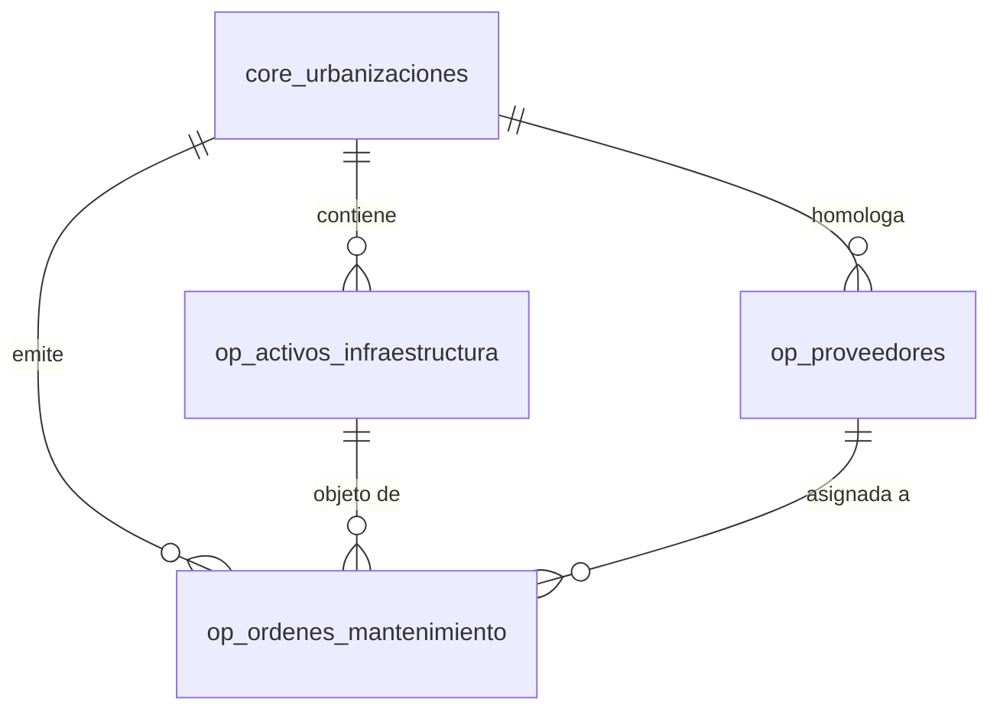

# Informe Técnico & Manual de Operación: Mantenimiento Preventivo, Activos & Facility Management
**Proyecto:** Residia SaaS • Plataforma Integral Multi-Urbanizaciones  
**Módulo:** Gestión de Infraestructura, Órdenes de Trabajo y Contratistas  
**Versión:** 1.0.0  
**Fecha:** 19 de Octubre de 2026  
**Auditoría & Trazabilidad:** Cumple estándar Robledal Connecting & CDC `AuditLogger`  

---

## 1. Resumen Ejecutivo & Justificación
La correcta conservación de la plusvalía en urbanizaciones residenciales depende de la operatividad continua de su infraestructura crítica (sistemas hidroneumáticos de agua potable, generadores diésel de emergencia, motores de barreras vehiculares, tableros eléctricos y piscinas). 

Este módulo dota a la Administración y al Directorio de:
1. **Catálogo Maestro de Activos (`op_activos_infraestructura`):** Registro de equipos con ubicación física, ficha técnica, frecuencia de mantenimiento preventivo (días) y cálculo automático de fecha del próximo servicio.
2. **Registro de Contratistas & Proveedores (`op_proveedores`):** Directorio de empresas de servicios homologadas con datos de contacto técnico, especialidad y RUC.
3. **Flujo de Órdenes de Trabajo (`op_ordenes_mantenimiento`):** Ciclo de vida formal con folio único (`MNT-YYYY-XXXX`), estados (`PENDIENTE`, `EN_PROCESO`, `COMPLETADA`, `CANCELADA`), control de costos (presupuestado vs. liquidado) y pre-autorización vehicular en garita para técnicos externos.

---

## 2. Esquema Relacional de Base de Datos (PostgreSQL)

### Tablas Principales:
1. **`residia.op_activos_infraestructura`**: Código (`BOMB-01`, `GEN-01`), categoría, frecuencia de servicio, estado operativo (`OPERATIVO`, `REQUIERE_SERVICIO`, `FUERA_DE_SERVICIO`).
2. **`residia.op_proveedores`**: Razón social, RUC, categoría, teléfono, persona de contacto y estado.
3. **`residia.op_ordenes_mantenimiento`**: Folio inmutable, tipo (`PREVENTIVO`, `CORRECTIVO`, `EMERGENCIA`), fechas de programación/cierre, costos y bitácora técnica de cierre.

---

## 3. Endpoints de la API REST (`MantenimientoController.php`)

| Método | Endpoint | Middleware | Descripción |
| :--- | :--- | :--- | :--- |
| `GET` | `/api/mantenimiento` | `auth:api`, `urbanizacion.scope` | Listado consolidado de órdenes, catálogo de activos, contratistas y 4 KPIs ejecutivos. |
| `POST` | `/api/mantenimiento/ordenes` | `auth:api`, `urbanizacion.scope` | Creación de orden de trabajo con auto-generación de folio consecutivo. |
| `POST` | `/api/mantenimiento/ordenes/{id}/estado` | `auth:api`, `urbanizacion.scope` | Actualización de estado, liquidación de costo real y recálculo automático del próximo servicio en el activo. |
| `POST` | `/api/mantenimiento/activos` | `auth:api`, `urbanizacion.scope` | Registro de nuevos equipos en el parque de infraestructura. |
| `POST` | `/api/mantenimiento/proveedores` | `auth:api`, `urbanizacion.scope` | Registro y homologación de contratistas externos. |

---

## 4. Reglas de Negocio & Cierre Automático
1. **Recálculo de Próximo Mantenimiento:** Cuando una orden con activo asignado pasa a estado `COMPLETADA`:
   - Se actualiza `act_ultimo_mantenimiento = NOW()`.
   - Se calcula `act_proximo_mantenimiento = NOW() + INTERVAL 'frecuencia_dias' DAY`.
   - El estado del activo pasa automáticamente a `OPERATIVO`.
2. **Pre-autorización en Garita:** El parámetro `ord_pre_autoriza_garita = true` habilita al personal de seguridad en garita para otorgar acceso expedito a los vehículos del contratista registrado en la fecha programada.
3. **Auditoría Forense CDC:** Toda creación o modificación de orden queda registrada en `aud_trazabilidad` mediante `AuditLogger::log`.

---

## 5. Experiencia de Usuario Frontend (`MantenimientoView.vue`)
- **4 KPI Cards:** *Órdenes en Curso*, *Inversión Ejecutada Mes*, *Activos en Alerta* y *Total Activos*.
- **Pestaña 1 (Órdenes de Trabajo):** Data-Grid completa con filtro por estado (`Todos`, `Pendiente`, `En Proceso`, `Completada`), búsqueda reactiva y modal de gestión/cierre.
- **Pestaña 2 (Catálogo de Activos):** Tarjetas con código, ubicación, días de frecuencia y semáforo visual de estado.
- **Pestaña 3 (Contratistas):** Tarjetas de proveedores con contacto directo, teléfono y RUC.
