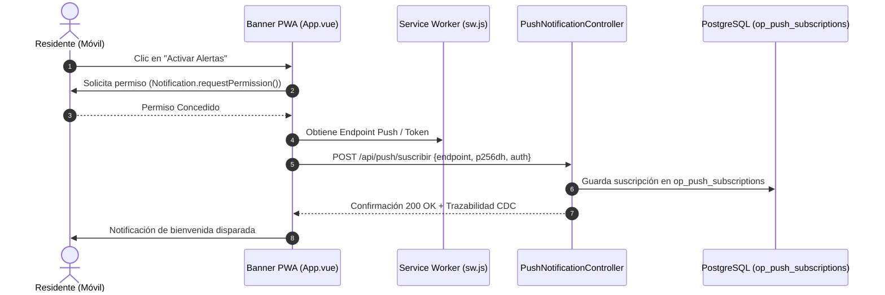

# Informe Técnico & Manual de Operación: Despliegue PWA Móvil & Notificaciones Web Push
**Proyecto:** Residia SaaS • Plataforma Integral Multi-Urbanizaciones  
**Módulo:** Aplicación Web Progresiva (PWA), Notificaciones Push & Movilidad  
**Versión:** 1.0.0  
**Fecha:** 19 de Octubre de 2026  
**Auditoría & Trazabilidad:** Cumple estándar Robledal Connecting & CDC `AuditLogger`  

---

## 1. Resumen Ejecutivo
Para maximizar la tasa de adopción de los residentes y agilizar el control de visitas en garita, Residia ahora cuenta con capacidades nativas de **Progressive Web App (PWA)**:
1. **Instalación Directa 1-Clic:** Los residentes pueden agregar la aplicación a la pantalla de inicio de su teléfono móvil (Android o iOS) directamente desde el navegador, sin pasar obligatoriamente por tiendas de aplicaciones y con un consumo de almacenamiento inferior a 2 MB.
2. **Service Worker Offline Resiliente (`public/sw.js`):** Almacenamiento en caché de la interfaz base y recursos estáticos, garantizando tiempos de carga casi instantáneos incluso con conectividad móvil deficiente en garita o sótanos.
3. **Notificaciones Web Push Nativas:** Soporte para suscripciones push (`Notification API` y Service Worker `push` / `notificationclick`) para avisar a los residentes en tiempo real sobre:
   - Llegada de visitas o deliveries a la garita principal.
   - Correspondencia y encomiendas en custodia.
   - Convocatorias urgentes de asamblea y votaciones electrónicas.

---

## 2. Arquitectura PWA & Flujo de Suscripción Push



---

## 3. Modelo de Datos (PostgreSQL)

### Tabla `residia.op_push_subscriptions`
```sql
CREATE TABLE IF NOT EXISTS residia.op_push_subscriptions (
    sub_id BIGSERIAL PRIMARY KEY,
    sub_urbanizacion_id UUID NOT NULL REFERENCES residia.core_urbanizaciones(urb_id) ON DELETE CASCADE,
    sub_user_id BIGINT REFERENCES residia.sec_users(usr_id) ON DELETE SET NULL,
    sub_persona_id BIGINT REFERENCES residia.core_personas(per_id) ON DELETE SET NULL,
    sub_endpoint TEXT NOT NULL,
    sub_p256dh VARCHAR(255),
    sub_auth VARCHAR(255),
    sub_user_agent VARCHAR(255),
    sub_activo BOOLEAN DEFAULT TRUE,
    created_at TIMESTAMP WITHOUT TIME ZONE,
    updated_at TIMESTAMP WITHOUT TIME ZONE
);
```

---

## 4. Endpoints de la API REST (`PushNotificationController.php`)

| Método | Endpoint | Middleware | Descripción |
| :--- | :--- | :--- | :--- |
| `POST` | `/api/push/suscribir` | `auth:api`, `urbanizacion.scope` | Registra el token push y claves criptográficas del navegador móvil. |
| `POST` | `/api/push/enviar-prueba` | `auth:api`, `urbanizacion.scope` | Despacho de alertas masivas o a predios específicos con registro CDC. |
| `GET` | `/api/push/estado-pwa` | `auth:api`, `urbanizacion.scope` | Métricas de adopción móvil (total de dispositivos y desglose por SO / navegador). |

---

## 5. Manifiesto e Iconografía PWA
- **Archivo de Configuración:** `public/manifest.json`.
- **Modo de Visualización:** `standalone` (apariencia de aplicación nativa sin barra de direcciones del navegador).
- **Tema de Color:** `#0284c7` (Azul Cian Robledal) y fondo `#090d16`.
- **Iconos Generados:**
  - `public/icons/icon-192.png` (192x192 px, propósito maskable)
  - `public/icons/icon-512.png` (512x512 px, propósito maskable)

---

## 6. Experiencia de Usuario & Componente (`PwaInstallBanner.vue`)
- Banner inferior elegante con desenfoque de fondo (*backdrop blur*) y microanimación `slide-up`.
- Detección reactiva del evento nativo `beforeinstallprompt`.
- Botón interactivo para solicitar permisos de notificación con confirmación en vivo.
